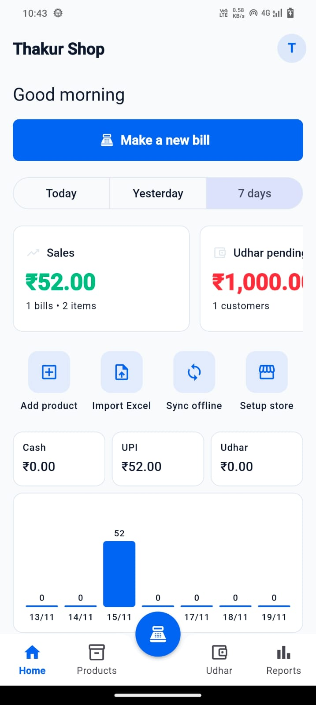
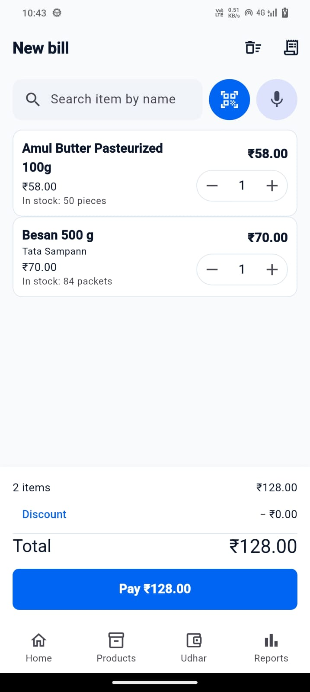
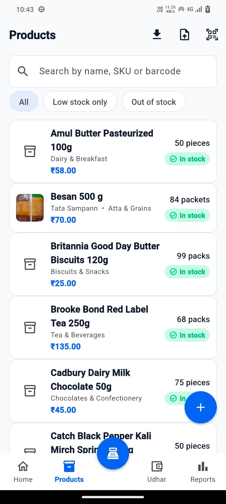
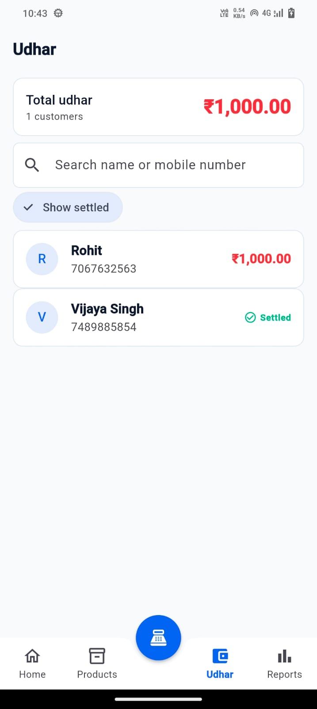

# Apna Shop

Simple stock, billing and udhar (credit) app for Indian kirana stores.
Built with Flutter and Firebase, in English and Hindi, and made for a real
shopkeeper in Madhya Pradesh.

<p>
  
  
  
  
</p>

## What it does

**Billing**
- Scan item barcodes (camera or from a photo), search by name or add by voice
- Quantity steppers, kg / litre items, discount, cash / UPI / udhar split
- PDF bills in 4 templates, with a UPI QR code for udhar bills
- Works offline: bills are saved on the phone and sync by themselves when
  the internet returns

**Stock**
- Products with brand, category, unit, prices and low-stock alerts
- Stock in / out with an append-only history (products are archived, never deleted)
- Fast set-up: import from Excel / CSV, or from a photo of a bill or list (OCR)
- Order list of low-stock items as a PDF, products CSV backup

**Udhar**
- Customer ledger with bills and payments, outstanding balance per customer
- Record payments (cash / UPI) with quick amounts

**Reports**
- Sales, profit and payment split by day / week / month, CSV export

**More**
- Roles: owner, manager, staff (enforced by Firestore security rules)
- English and Hindi, light and dark theme, set from Profile & settings
- Time-based greeting with the owner's name

## Tech

| Area | Choice |
| --- | --- |
| UI | Flutter 3, Material 3, Inter font |
| Architecture | Feature-first, MVVM |
| State | Riverpod 3 |
| Navigation | go_router (`StatefulShellRoute`) |
| Backend | Firebase Auth + Cloud Firestore (Spark plan, no Cloud Functions) |
| Scanning / OCR | `mobile_scanner`, `image_picker`, `google_mlkit_text_recognition` |
| PDF | `pdf`, `printing` |
| Localisation | `gen-l10n` with English and Hindi arb files |

Design rules the code follows:
- Money is stored as integer paise, never floating point
- Stock changes are append-only movements, written in Firestore transactions
- Integrity is enforced in `firestore.rules`, not only in the app

## Run it

```
flutter pub get
flutter gen-l10n
flutter run
```

You need your own Firebase project: create one, enable Email/Password sign-in
and Firestore, run `flutterfire configure`, and deploy `firestore.rules` and
`firestore.indexes.json`.

```
dart format .
flutter analyze
flutter test
```

## Build an APK

See [RELEASE.md](RELEASE.md).

## Status

Built for a real kirana shopkeeper; being tested before rollout. Ideas for later:
product expiry dates, multiple stores, barcode label printing.